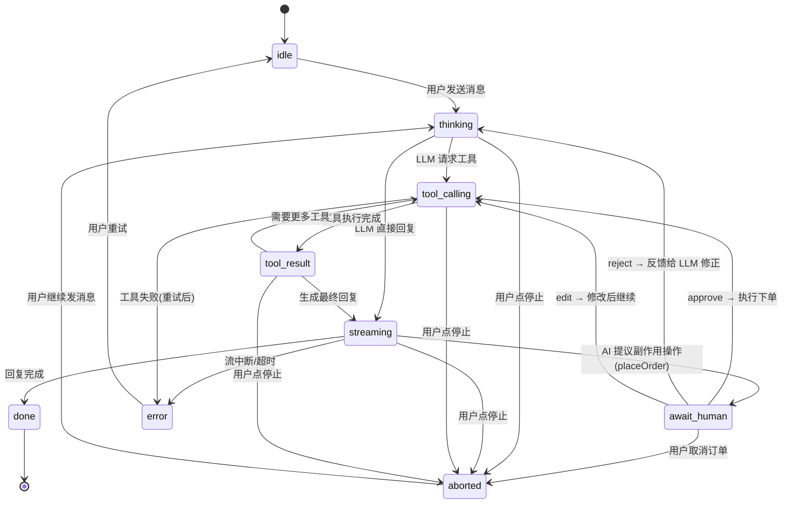

# Connect Store · AI 导购助手（Showcase 施工设计文档）

> 版本：v0.4（2026-10-16，✅ 已确认）
> 作者：Alice（自研项目）
> 定位：Showcase —— AI 前端架构师（Agent 交互 + Streaming UI + Generative UI + HITL）
> 职责边界（2026-10-13 定，2026-10-16 收紧）：承担 **AI 交互层**证据（Generative UI / 状态机投影 / HITL）+ React 底层深度；**不**承担检索/编排层证据（RAG / 混合检索 / 多 Agent 编排由 newtalk 承担，避免重复）。v0.4 据此**撤销 BFF 内语义检索**（原 D6）
> 对齐：阿里 #40（AI前端开发-商品&库存，Generative UI + Agent + 流式）、#17（智能搜索，对话式导购）；8/31 趋势报告 P0/P1

---

## 1. 背景与目标

### 1.1 现状盘点（connect-store 已有资产，不重复造）

| 资产            | 内容                                                                                                                        | 施工中如何使用                                                                              |
| --------------- | --------------------------------------------------------------------------------------------------------------------------- | ------------------------------------------------------------------------------------------- |
| catalog feature | 数字资产目录：无限滚动/搜索/筛选/排序/主题系统/CLS 优化/URL 状态同步                                                        | 作为 Agent 工具调用的**数据源与落点**（AI 帮用户筛目录）                                    |
| productApi      | 真实远程 API（`closet-recruiting-api.azurewebsites.net/api/data`，**一次返回全量数组、无查询参数**）+ 重试/校验/AbortSignal | 保留；dev 环境经 Vite proxy 指向 BFF **同一份快照**（数据同源，避免 AI 推荐与目录页不一致） |
| Zustand store   | useCatalogStore（分页/加载/取消）                                                                                           | 新增 useCartStore / useAssistantStore 沿用模式                                              |
| 测试体系        | 27 个自动化测试（Vitest + RTL）100% 通过                                                                                    | 新增测试沿用；状态机用转换表驱动测试                                                        |
| 工程化          | ESLint/Prettier/Husky/Commitlint/CI(GitHub Actions)                                                                         | TS7 升级时同步适配                                                                          |
| 设计系统        | SCSS Modules + CSS Variables（themes/variables/globals）                                                                    | 新组件沿用 token，不引入 Tailwind（避免双体系）                                             |
| Product 类型    | `id/creator/title/pricingOption/imagePath/price`（**无 description / tags**）                                               | 仅 title/creator 含文本 → **不做向量检索**的客观判据（见 §1.3）                             |

> **实测基线（2026-10-16，本机）**：分支 `feat/ai-assistant`、工作区干净；`npm test` = 4 文件 / **27 测试全绿，2.77s**；远程接口一次性返回全量数组，筛选 / 排序 / 分页均在客户端完成（`catalogSelectors.ts`）。

### 1.2 目标

1. **Streaming UI**：流式对话（官方 UI 消息流，SSE 传输）+ 打字机渲染（简历最强匹配项）
2. **Agent 交互可视化**：Tool Calling 面板（工具名/参数/耗时）+ 执行状态机投影
3. **Generative UI**：AI 意图 → 动态渲染商品卡片（组件注册表，非静态列表）
4. **HITL**：下单前人工审批（产品语义，不是 loading）——Showcase 核心亮点；**按影响面分级**（小额自动 / 大额强制人工），落地为 `toolApproval` 策略函数（见 §4/§6.2）
5. **质量工程**：状态转换表驱动测试 + mock LLM 确定性测试

### 1.3 非目标（边界）

- 不做完整支付/真实下单（mock 订单，审批流是重点）
- 不做用户账户/鉴权体系（后端仅保护 LLM API Key）
- **不做语义检索 / 向量召回 / embedding（2026-10-16 撤销原 D6）**：理由三条 —— ①职责边界：检索层证据由 newtalk 承担，本 Showcase 聚焦 AI 交互层，避免重复叙事；②客观输入缺失：`Product` 无 `description`/`tags` 字段，语义检索连输入都没有（须先造 mock 描述，属为做而做）；③规模不匹配：商品百级，向量索引对比结构化过滤无实际收益
- **不引入向量数据库 / RAG 平台**（Pinecone/Chroma/Qdrant）；**也不引入 embedding 端点**（不占 `/v1/embeddings`；`EMBEDDING_MODEL`、`server/retrieval/`、`data/descriptions.ts` 一并移除）
- **检索能力的实际边界（诚实声明）**：`searchCatalog` 的 `query` 走 title/creator **子串匹配**（复用存量 `filterProducts` 语义）；风格/场景类需求（"赛博朋克、适合游戏封面"）由 **LLM 做 query understanding** 拆成关键词 + 结构化参数后多轮调用工具。**边界：title/creator 中无相关词的查不到**（无同义词扩展、无向量召回）

---

## 2. 产品定位

**Connect Store AI 导购助手**：在现有数字资产目录上，新增一个对话式导购入口。用户用自然语言找素材（「帮我找免费的 3D 素材」「20 刀以内适合做封面的」），AI 通过工具调用操作目录，**生成式地渲染商品结果**，并可在用户确认后**代为下单（需审批）**。

用户旅程：

```
用户对话 → AI 理解意图 → 工具调用搜索/筛选 → Generative UI 渲染结果
→ 用户选中加购 → AI 提议下单 → ⏸️ HITL 审批（approve/reject/edit） → 完成
```

---

## 3. 总体架构

```
┌─────────────────────────────────────────────────┐
│ 前端 (React 19 + TS7 + Vite8 + Zustand)         │
│                                                 │
│  features/assistant                             │
│    ChatPanel（流式渲染）                        │
│    ToolCallPanel（工具执行可视化）              │
│    ApprovalCard（HITL 审批卡片）                │
│    AgentStatusBadge（状态机投影）               │
│  features/cart（购物车侧栏 + 下单入口）         │
│  features/catalog（现有，不改，作为工具落点）   │
│                                                 │
│  state: useAssistantStore（状态机+事件日志）    │
│         useCartStore（购物车）                  │
└─────────────────────────────────────────────────┘
               │ POST /api/chat（官方 UI 消息流）
┌───────────────────────────────────────────────────┐
│ BFF (Node + Hono + AI SDK v7)                     │
│  POST /api/chat    → 工具回路 + 官方 UI 消息流    │
│  POST /api/orders  → 审批状态/下单（BFF 订单表）  │
│  tools: searchCatalog / getProductDetails         │
│         addToCart / placeOrder(需审批)            │
│  approvals: toolApproval + 签名(防伪造)           │
│  env: LLM_API_KEY / LLM_BASE_URL / APPROVAL_SECRET│
└───────────────────────────────────────────────────┘
```

**技术决策**：

- **AI SDK（Vercel）**：`ai`（实测 v7，`latest` = 7.0.142 / 2026-10-15；8/31 报告 P1：2,356 万/周、242 次/90天发布的"事实标准层"）；服务端 `streamText` + tools + `toolApproval`
- **前端消费方式 = 自研传输层 + 官方消息协议（2026-10-16 拍板）**：`chatApi.ts` 自研传输（fetch + 流读取），**协议走官方 UI 消息流**（`UIMessageChunk`，可用官方 `readUIMessageStream` 助手；工具部件命名 `tool-${toolName}`），**不自造事件格式**——守住"前端消费事件做投影，不发明协议"这条立场。不采用 `useChat`：状态机需完全自主可控、测试须确定性（放弃的是 SDK 的客户端 hook，不是协议）
- **版本风险与隔离**：`ai` 的 5.x / 6.x / 7.x **同日在并行发布**（npm 实测 10-15 三线同时出新版），服务端流式 API 名已变更过（`toDataStreamResponse` → `createUIMessageStreamResponse` + `toUIMessageStream`）→ 传输层与 SDK 的接触面收敛在 `chatApi.ts` + `server/chat.ts` 两处，升级失败可回退自研解析
- **BFF 必要性**：LLM API Key 不能进前端（安全）；流式协议在服务端编排；与 JD「Node/BFF 41 次」对齐
- **Hono**：轻量、TS 类型友好、路由简洁（ADR D2 拍板）；不引 FastAPI（那是 bagujing 的 Python 线，本 Showcase 聚焦 JS 全栈）
- **不引入 Tailwind**：现有 SCSS tokens 体系已成立，双体系是架构负债

---

## 4. Agent 工具协议

| 工具                | 参数                                                      | 副作用级别       | HITL   | 说明                                                                                                                                                                                                                                          |
| ------------------- | --------------------------------------------------------- | ---------------- | ------ | --------------------------------------------------------------------------------------------------------------------------------------------------------------------------------------------------------------------------------------------- |
| `searchCatalog`     | `{ query?, pricingOption?, sort?, maxPrice?, minPrice? }` | 只读             | 否     | **结构化查询（唯一检索工具，2026-10-16 起）**：关键词（title/creator 子串匹配）/ 免费·付费·仅查看 / 排序 / **价格区间**。`maxPrice`/`minPrice` 为 BFF 侧新增能力（存量前端仅有排序与计价方式过滤，**无价格区间**）——支撑 §2 的"20 刀以内"示例 |
| `getProductDetails` | `{ id }`                                                  | 只读             | 否     | 商品详情                                                                                                                                                                                                                                      |
| `addToCart`         | `{ productId, quantity }`                                 | 低（可逆）       | 否     | 自动执行，UI 展示加购成功                                                                                                                                                                                                                     |
| `placeOrder`        | `{ cartId }`                                              | **高（不可逆）** | **是** | **必须先审批，后端收到批准后才执行**                                                                                                                                                                                                          |

**单通道 + 模型侧 query understanding**（架构决策，面试可讲）：检索只有 `searchCatalog` 一条通道 —— **语义理解放模型层，精确过滤放工具层**。"20 刀以内" → `{ maxPrice: 20 }`；"适合做游戏封面的赛博朋克素材" → 模型拆成 `{ query: 'cyberpunk' }`（或拆多个关键词多轮调用）；两者混合 → 多轮工具调用逐步收敛。检索结果始终是**工具入参与返回值**，不是注入 prompt 的隐藏魔法，前端展示与之一致。**能力边界见 §1.3**。

**为什么不自建检索**（面试可讲，回答"为什么不做 RAG/向量检索"）：①职责边界——检索层证据由 newtalk 承担；②输入缺失——`Product` 无 `description`/`tags`；③规模不匹配——百级商品用结构化过滤足够。把"语义理解"交给模型、"精确过滤"交给工具，是当下更省的架构选择。

**HITL 分级原则**（架构决策，面试可讲）：

> 副作用可逆 → 自动执行 + UI 反馈；副作用不可逆/涉及资金 → 强制审批。分级依据 = 可逆性 + 影响面，不是工具大小。

**落地形式（2026-10-16 定）**：分级不是文案而是**可运行的策略函数** —— `toolApproval` 按工具入参判定：`addToCart`（可逆）恒为自动执行；`placeOrder`（不可逆）恒为 `'user-approval'`；并演示**阈值分级**（订单金额 ≤ 阈值自动执行、> 阈值强制人工；官方文档同构示例 `amount > 1000 ? 'user-approval' : undefined`）。同一会话内可并排演示"自动执行"与"强制审批"两种副作用级别——这正对应"mock 订单无真实资金代价"这一质疑的答法：**审批的意义在于把"不可逆副作用必须有审批点"落成可运行实现，而非金额本身**。

---

## 5. 状态机设计（前端投影，核心）



**口径声明（2026-10-16）**：**7 主体状态** = idle / thinking / tool_calling / tool_result / streaming / await_human / done；**2 附加态** = error / aborted；合计 **9 个节点**。**唯一终态 = done**（`done → [*]`）。路径 **≥7 条**（含 error 与 `aborted` 分支）——达标线：08-08 补考题原为 ≥6 条，因 v0.4 新增 `aborted` 分支提高至 ≥7 条。

**aborted（用户主动取消）三条约束**（2026-10-16 定；缺任一条即为冗余状态）：

1. **出边**：`aborted → thinking`（用户继续发消息，与 `idle → thinking` 同构）；**不显示"重试"按钮**、不自动重发（"重试"语义只属于 `error`）。
2. **非终态**：有出边故非终态，口径 = "用户主动取消后停驻，入口是重新发消息"。
3. **与审批取消统一**：`await_human → aborted`（用户取消订单）取代原 `await_human → done: 用户取消`——全系统"用户主动取消"只有 `aborted` 一个去向，`done` 只表示成功完成。

**取消语义 ≠ 失败语义**（面试可讲）：对齐浏览器 `AbortError`（`signal.aborted`）—— 主动取消必须与网络错误分开展示，否则会对用户自己的取消误报错误。

**事件日志**（支撑恢复/审计叙事）：每次转换记录 `{ from, to, event, tool?, args?, result?, ts, durationMs }`，存内存环形缓冲（上限 200 条），前端可展开查看。`event` = 触发事件枚举（`USER_SEND` / `TOOL_CALL` / `TOOL_RESULT` / `STREAM_END` / `APPROVAL_REQUEST` / `APPROVE` / `REJECT` / `EDIT` / `USER_ABORT` / `RETRY` / `ERROR`）；状态机以**转换表** `(state, event) → next` 驱动，非法组合显式拒绝（G2.2 测试目标）。

**UI = 状态投影**：组件不自己"决定"状态，只消费 store 的状态渲染对应面板。`await_human` 是产品语义（等审批），不是 loading。

---

## 6. HITL 审批流设计

### 6.1 流程

```
AI 生成 placeOrder 提议
  → 前端进入 await_human
  → ApprovalCard 展示：订单摘要（商品列表/数量/合计金额）+ 三按钮
  → approve:   POST /api/orders → 后端执行下单 → 返回订单号 → 状态机 tool_result → streaming → done
  → reject:    反馈给 LLM（"用户拒绝：太贵了"）→ 回到 thinking → AI 调整方案（如换低价商品）
  → edit:      用户修改数量/移除商品 → **不发审批响应**，带修改后的购物车重新发起下单（新 toolCall）→ 再次审批
```

### 6.2 与 SDK 的关系（2026-10-16 实测后重写）

**形态已确认（不再是未知风险）**：AI SDK v7 原生提供 `toolApproval`（`ToolLoopAgent` / `streamText` / `generateText`），状态取值为 `'not-applicable' | 'approved' | 'denied' | 'user-approval'`；工具被拦时返回 `tool-approval-request` 而非执行；前端用 `addToolApprovalResponse({ id, approved })` 回应，配 `sendAutomaticallyWhen: lastAssistantMessageIsCompleteWithApprovalResponses` 自动续跑。

**分层方案（2026-10-16 决策）**：

| 层                 | 承担者               | 内容                                                                                                                |
| ------------------ | -------------------- | ------------------------------------------------------------------------------------------------------------------- |
| 审批**协议**层     | **AI SDK 原生**      | `toolApproval` 策略（含阈值分级）、`tool-approval-request/response` 流、`experimental_toolApprovalSecret` HMAC 签名 |
| 审批**业务状态**层 | **自建：BFF 订单表** | `pending/approved/rejected/expired` + `issuedAt` + TTL + **按 orderId 查询恢复** + 审计日志                         |

**SDK 不提供、必须自建的四件事**（实测确认）：① `edit` 出边（绕行实现见 §6.1）；② TTL 的签发时刻记录；③ 按 orderId 查询订单状态（对应 `API-AI-04`）；④ 审计事件日志。

**TTL / expired 的实现路径**（置信度：中高，**开工前需 30 分钟最小实测**）：`toolApproval` 的返回值不能新增状态名，但官方文档明确：审批随消息历史回放时会 "be re-validated before execution"，即**每次都会重新调用该策略回调**。因此在回调内查自维护的签发时刻表，超时即 `return { type: 'denied', reason: 'approval expired' }` —— **`expired` 语义落在 `denied` + `reason` 上**，前端按 reason 区分展示（"审批已超时，请重新发起"）。**若实测不成立 → 才退回纯自研 pending 队列**（届时尚需自实现签名防伪造，成本更高）。

**签名是必须项（安全）**：官方文档指出，标准模式下服务端不持久化会话、消息历史为**客户端可控输入** → 客户端可伪造一个格式合法的审批**绕过 HITL**；只有配置 `experimental_toolApprovalSecret`，才把审批 HMAC 绑定到服务端签发的 toolName + toolCallId + input。**这是 `API-AI-01`（未审批直接下单须被拦截）的官方依据解法。**

- 架构立场不变：**前端消费事件做投影，不发明协议**（消息协议走官方 UI 消息流，见 §7/§8）

### 6.3 审批协议类型定义

```ts
// 前端 → BFF 审批决策
type ApprovalDecision =
  | { type: 'approve'; orderId: string }
  | { type: 'reject'; orderId: string; reason: string } // reason 反馈给 LLM
  | { type: 'edit'; orderId: string; edits: CartItem[] }; // 改数量/删项后继续

// BFF 审批状态机
type ApprovalState =
  | { status: 'pending'; order: OrderDraft; createdAt: number; expiresAt: number }
  | { status: 'approved'; order: Order; executedAt: string }
  | { status: 'rejected'; orderId: string; reason: string }
  | { status: 'expired'; orderId: string }; // 超时未决 → 自动取消
```

**超时兜底（两个判定点）**：① `toolApproval` 回调内校验签发时刻（超时 → `denied` + `reason: 'approval expired'`，见 §6.2）；② **BFF 订单表惰性过期**：`pending` 超 TTL（默认 5 分钟）→ `expired`，前端查询时即得该状态并提示「审批已超时，请重新发起」。审批状态存 **BFF 内存**（按 orderId 查询，不依赖 SSE 连接存活），断线重连后可恢复查询（`API-AI-04`）。

---

## 7. 前端结构

```
src/features/assistant/
├── components/
│   ├── ChatPanel.tsx          # 对话主面板（消息列表 + 输入框）
│   ├── MessageBubble.tsx      # 单条消息（含工具面板/审批卡占位）
│   ├── StreamingText.tsx      # 打字机渲染（流式分片）
│   ├── ToolCallPanel.tsx      # 工具执行可视化（名称/参数/耗时）
│   ├── ApprovalCard.tsx       # HITL 审批卡片（三按钮）
│   └── AgentStatusBadge.tsx   # 状态机投影（idle/thinking/...）
├── state/
│   ├── assistantMachine.ts    # 状态机（纯函数，转换表驱动测试）
│   └── useAssistantStore.ts   # 状态 + 事件日志 + action
├── services/
│   └── chatApi.ts             # 自研传输层：POST /api/chat + 消费官方 UI 消息流（readUIMessageStream）
├── registry/
│   └── uiRegistry.tsx         # Generative UI 注册表：part.type → 渲染分发函数（白名单）
└── types/
    └── assistant.ts           # 消息/状态/工具调用类型

src/features/cart/
├── components/CartDrawer.tsx  # 购物车侧栏
├── store/useCartStore.ts      # 购物车状态（增删改/合计）
└── types/cart.ts
```

### Generative UI 组件注册表（白名单，安全边界）

```tsx
// uiRegistry.tsx —— part.type（官方 tool-${toolName} 命名）→ 渲染分发（白名单模式）
// 注册表 value 是「渲染决策」而非单个组件：一个 key 可分发到多个组件
export const UI_REGISTRY: Record<string, (part: ToolPart) => ReactNode> = {
  'tool-searchCatalog': (part) =>
    part.state === 'output-error' ? (
      <ToolError part={part} />
    ) : part.output.items.length === 0 ? (
      <EmptyState /> // 复用存量 EmptyState
    ) : (
      <ProductGrid>
        {part.output.items.map((p) => (
          <ProductCard key={p.id} product={p} />
        ))}
      </ProductGrid>
    ),
  'tool-getProductDetails': (part) => <PriceBreakdown product={part.output} />,
  'tool-placeOrder': (part) => <ApprovalCard part={part} />, // 内嵌 OrderSummary
  // 未注册的 toolName（含 dynamic tool call）→ 一律降级为文本，绝不渲染任意组件
};
```

**注册表（key ↔ 组件 ↔ props）**：

| registry key（`part.type`）      | 组件                            | 复用存量          | props / schema 要点                                  |
| -------------------------------- | ------------------------------- | ----------------- | ---------------------------------------------------- |
| `tool-searchCatalog`（命中）     | `ProductGrid` + `ProductCard`   | ✅ 两个纯展示组件 | `items: Product[]`（上限条数）；`Product` 为存量类型 |
| `tool-searchCatalog`（空结果）   | `EmptyState`                    | ✅                | 复用存量文案（"No contents matched…"）               |
| `tool-searchCatalog`（工具失败） | `ToolError`                     | ❌ 新写（轻量）   | `message: string`                                    |
| `tool-getProductDetails`         | `PriceBreakdown`                | ❌ 新写           | 价格 / 计价方式 / 拆分项；货币口径与存量一致（`$`）  |
| `tool-placeOrder`（审批态）      | `ApprovalCard` + `OrderSummary` | ❌ 新写           | items / quantity / total；不可逆提示                 |

**复用可行性（已实测代码）**：`ProductGrid`（11 行，`({ children }) => <section className={styles.grid}>`）与 `ProductCard`（`({ product }: { product: Product })`）均为**纯展示组件、零 store 耦合** → 直接复用，不另写容器（理由同 D1：新容器 = 视觉 / CLS / A11y 三份维护）。`EmptyState` 复用存量。
**已知风险**：`styles.grid` 为响应式栅格（480/768/1200 → 1/2/3/4 列），在对话气泡的窄宽度内会退化为 1 列——若需多列，在气泡内加一个覆盖列数的 wrapper（**不改进存量组件**）。

**安全边界**：白名单 = 「前端认识的 `toolName` 集合」→ **模型无法伪造组件标识**（比"模型返回组件 id"更强的边界）；未注册 key（含 dynamic tool call）一律降级文本。**不渲染任意 HTML/组件、不把 LLM 原始输出当代码执行**（8/31 报告 Generative UI 安全边界三件套之一）。

---

## 8. 后端结构（BFF）

```
server/
├── index.ts          # Hono 入口 + 中间件（CORS 白名单/请求体限制）
├── chat.ts           # POST /api/chat → streamText + tools + toolApproval（官方 UI 消息流）
├── orders.ts         # 审批业务状态层：订单表（pending/approved/rejected/expired + issuedAt + TTL）+ 按 orderId 查询 + 下单执行（mock）
├── approvals.ts      # toolApproval 策略（阈值分级 + TTL 校验 + 签发时刻表）+ toolApprovalSecret 配置
├── tools/
│   ├── searchCatalog.ts     # 结构化查询：关键词(title/creator) + 免费/付费/仅查看 + 排序 + 价格区间(maxPrice/minPrice)
│   ├── getProductDetails.ts
│   ├── addToCart.ts
│   └── placeOrder.ts        # 副作用工具：'user-approval'，校验订单表状态后才执行
├── data/
│   └── products.ts          # 数据层：冻结快照（远程 /api/data 一次性导出）+ **真实执行**筛选/排序/区间过滤（数据 mock、逻辑真跑）
└── env.ts            # LLM_API_KEY / LLM_BASE_URL / LLM_MODEL / APPROVAL_SECRET / PORT（OpenAI-compatible；.env，gitignore；与 ADR D4/D9 一致）
```

**安全**（面试可讲）：API Key 仅服务端持有；CORS 限制同源；请求体大小限制；不把 LLM 原始输出当代码执行；**审批签名**（`experimental_toolApprovalSecret`，绑定服务端签发的 toolName + toolCallId + input，防客户端伪造审批绕过 HITL）。

**数据源同源（2026-10-16 定）**：BFF 读**冻结快照**（远程 `/api/data` 的一次导出，全量数组）→ 测试与演示确定性；dev 环境在 `vite.config.ts` 加一条 proxy，把该 URL 代理到 BFF 的同一份快照 → **目录页与 AI 推荐看到同一份数据**，避免演示时"AI 推荐的商品在目录页找不到 / 价格不一致"。改动面 = `productApi.ts` 一个常量 + proxy 一条规则（**不动组件**）。

---

## 9. 测试策略

| 层                     | 工具             | 测什么                                                                                      |
| ---------------------- | ---------------- | ------------------------------------------------------------------------------------------- |
| 状态机                 | Vitest（纯函数） | **转换表驱动测试**：≥6 条路径每条一个用例 + 非法转换拒绝                                    |
| Generative UI registry | Vitest           | 白名单 4 类用例：放行/拒绝/参数校验/拒绝响应                                                |
| 组件                   | RTL              | ChatPanel 流式渲染（fake timers + 分片 mock）/ ApprovalCard 三按钮                          |
| 传输层（自研）         | Vitest           | 构造 `UIMessageChunk` 受控流 → 断言 part 投影与状态转换（LLM 是不确定依赖，测试必须确定性） |
| 审批协议 + TTL         | Vitest           | approve / reject / edit / 超时(`expired`) / 未审批拦截(签名) 五类用例                       |
| E2E（可选）            | Playwright       | 完整旅程：对话→工具→加购→审批→下单                                                          |

---

## 10. 分阶段施工计划（每阶段有验证标准）

> 本文件为**唯一施工文档**（2026-09-01 确认）；历史计划记录归档于 `~/hermes-agent/.hermes/plans/`（仅对话回溯用），不再作为施工依据。开发全程在 `feat/ai-assistant` 分支进行。

### Phase 0：TS 5.9.3 → 7.0 升级（Day 3 任务合并，先做）

- 操作：`npm i -D typescript@7` → 适配 tsconfig/eslint(typescript-eslint)/vitest → `tsc -b` 全绿
- 产出：迁移实测数字（安装/构建/类型检查耗时前后对比）+ `docs/ts7-migration.md` 迁移记录
- 验证：`npm run build && npm test` 全绿（27 个测试不回归）；话术卡素材（真实项目迁移比空项目更有说服力）

### Phase 1：AI 导购骨架（流式对话）

- 后端：**hono**（ADR D2）+ `streamText` + `/api/chat`（官方 UI 消息流），无工具先跑通
- 前端：ChatPanel + StreamingText + chatApi（**自研传输层，消费官方 UI 消息流**）
- 验证：能流式对话；错误处理（网络断/500）；`npm test` 全绿

### Phase 2：工具调用 + 状态机 + Generative UI

- 后端：tools（searchCatalog **[含 maxPrice / minPrice]** / getProductDetails / addToCart）+ 数据层（冻结快照 + 真实过滤）
- 前端：assistantMachine（纯函数，含 `aborted`）+ useAssistantStore + ToolCallPanel + uiRegistry（官方 `tool-${toolName}` 分发 + 复用存量 ProductGrid/ProductCard/EmptyState）
- 验证：状态机 ≥6 路径单测全绿（**含 `aborted` 与 `await_human → aborted`**）；对话中能看到工具执行面板 + 动态商品卡；"20 刀以内"能正确过滤；**未注册 toolName 降级为文本**

### Phase 3：HITL 下单审批（SDK 原生协议 + 自建业务状态）

- 后端：`toolApproval`（`placeOrder: 'user-approval'` + 阈值分级）+ `experimental_toolApprovalSecret` 签名 + 订单表（TTL / expired / 按 orderId 查询）
- 前端：ApprovalCard（三出边）+ `addToolApprovalResponse` + await_human 状态 + cart feature（CartDrawer/useCartStore）
- 验证：完整闭环 demo（对话→推荐→加购→审批→下单→订单号）；reject 后 AI 修正链路跑通；edit 走"带修改重新发起"；超时 → expired；伪造审批被拦截（`API-AI-01`）

### Phase 4：收尾（文档 + 测试 + story）

- `docs/ai-assistant-design.md` 更新为最终版（含架构图 mermaid）
- README 5 分钟 story（对齐 vercel/ai-chatbot 范本）
- 补测试：registry 4 类用例 + 状态转换表 + mock LLM 确定性
- 验证：`npm run build && npm test` 全绿 + 手工走查全旅程 + 3 分钟口头讲述彩排

**预计投入**：Phase 0 半天 / Phase 1 1 天 / Phase 2 2 天（v0.3 为 2.5 天，剔除语义检索 0.5~1 天后取整并保留缓冲）/ Phase 3 2 天 / Phase 4 1 天 ≈ **6.5 天**（v0.3 为 7 天）
**与学习计划合流**：Phase 0 = Day 3 任务；Phase 2 状态机 = Day 6 架构图实物版；Phase 3 = Day 2 补考 08-08 实弹；做完再考，考得动。

---

## 11. 风险与边界（诚实声明）

1. **TTL / expired 的扩展路径待实测（2026-10-16 新列，置信中高）**：`toolApproval` 回调内的时间判定能否在审批复放时稳定生效，需**开工前 30 分钟最小实测**；不成立则退回纯自研 pending 队列（设计已留后路，见 §6.2）
2. **LLM API Key / 费用**：需可用的 OpenAI-compatible LLM API（env 配置；用户成本偏好 = 拒按 token 计费通道）；如无可用 key，Phase 1-2 用 mock 流先行，Phase 3 再真接；审批签名需另配 `APPROVAL_SECRET`（`openssl rand -base64 32`）
3. ~~embedding API 可用性~~ —— **已随语义检索撤销而作废（2026-10-16）**
4. **远程商品 API 不稳定**：已改为**冻结快照**（运行时工具层不直连远程）+ dev 同源代理；远程仅用于一次性导出快照，不影响运行时稳定性
5. **TS7 升级兼容性**：typescript-eslint/vitest 对 TS7 的适配状态需实测定；若 blocker 无法解决，降级方案 = TS 6.x 保持 + 记录原因（不编造）
6. **检索能力上限（诚实声明）**：仅 title/creator 子串匹配，无同义词扩展 / 向量召回；风格场景类需求依赖模型 query understanding 的质量
7. **范围控制**：非目标已在 §1.3 声明，Phase 中不扩展

---

## 12. 变更记录

| 日期       | 变更                                                                                                                                                                                                                                                                                                                                                                                                                                             | 状态      |
| ---------- | ------------------------------------------------------------------------------------------------------------------------------------------------------------------------------------------------------------------------------------------------------------------------------------------------------------------------------------------------------------------------------------------------------------------------------------------------ | --------- |
| 2026-09-01 | v0.3 定稿（用户拍板）：语义检索确认做（后于 2026-10-16 撤销）；Express → Hono；本文件确立为唯一施工文档 + 7 状态机为准；补 HITL 类型定义与超时兜底；统一环境变量命名；补 git 分支说明                                                                                                                                                                                                                                                            | ✅ 已确认 |
| 2026-10-13 | v0.3.1 职责边界收紧：本 Showcase 承担 AI 交互层证据（Generative UI / 状态机投影 / HITL）+ React 底层深度；检索 / 编排层证据归 newtalk，避免重复叙事                                                                                                                                                                                                                                                                                              | ✅ 已确认 |
| 2026-10-16 | v0.4：① 协议路线定为自研传输 + 官方 UI 消息流；② Generative UI 改官方 `tool-${toolName}` 分发 + 复用存量 ProductGrid / ProductCard / EmptyState；③ **撤销语义检索**（连带删 embedding / retrieval / descriptions）；④ 新增 `aborted` 状态（三条约束 + 审批取消统一）；⑤ HITL 改「SDK 原生 `toolApproval` + 签名 + 自建订单表」分层方案 + 阈值分级；⑥ `searchCatalog` 增 maxPrice / minPrice；⑦ 修 §10 Phase 1 的 Express 残留；⑧ 投入 7 → 6.5 天 | ✅ 已确认 |

---
