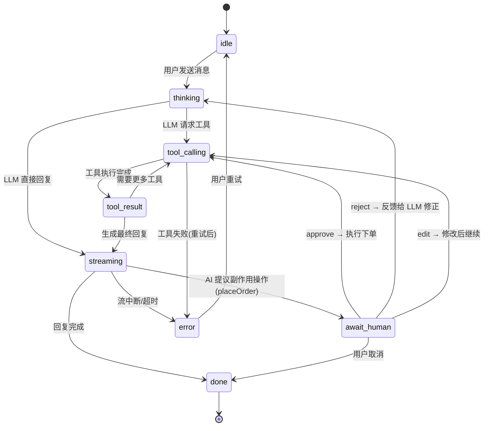

# Connect Store · AI 导购助手（Showcase 施工设计文档）

> 版本：v0.3（2026-09-01，✅ 已确认）
> 作者：Alice（自研项目）
> 定位：Showcase —— AI 前端架构师（Agent 交互 + Streaming UI + Generative UI + HITL）
> 对齐：阿里 #40（AI前端开发-商品&库存，Generative UI + Agent + 流式）、#17（智能搜索，对话式导购）；8/31 趋势报告 P0/P1

---

## 1. 背景与目标

### 1.1 现状盘点（connect-store 已有资产，不重复造）

| 资产            | 内容                                                                 | 施工中如何使用                                                |
| --------------- | -------------------------------------------------------------------- | ------------------------------------------------------------- |
| catalog feature | 数字资产目录：无限滚动/搜索/筛选/排序/主题系统/CLS 优化/URL 状态同步 | 作为 Agent 工具调用的**数据源与落点**（AI 帮用户筛目录）      |
| productApi      | 真实远程 API（Azure）+ 重试/校验/AbortSignal                         | 保留；Agent 工具 searchCatalog 可复用同一数据源（或本地缓存） |
| Zustand store   | useCatalogStore（分页/加载/取消）                                    | 新增 useCartStore / useAssistantStore 沿用模式                |
| 测试体系        | 27 个自动化测试（Vitest + RTL）100% 通过                             | 新增测试沿用；状态机用转换表驱动测试                          |
| 工程化          | ESLint/Prettier/Husky/Commitlint/CI(GitHub Actions)                  | TS7 升级时同步适配                                            |
| 设计系统        | SCSS Modules + CSS Variables（themes/variables/globals）             | 新组件沿用 token，不引入 Tailwind（避免双体系）               |

### 1.2 目标

1. **Streaming UI**：SSE 流式对话 + 打字机渲染（简历最强匹配项）
2. **Agent 交互可视化**：Tool Calling 面板（工具名/参数/耗时）+ 执行状态机投影
3. **Generative UI**：AI 意图 → 动态渲染商品卡片（组件注册表，非静态列表）
4. **HITL**：下单前人工审批（产品语义，不是 loading）——Showcase 核心亮点
5. **质量工程**：状态转换表驱动测试 + mock LLM 确定性测试

### 1.3 非目标（边界）

- 不做完整支付/真实下单（mock 订单，审批流是重点）
- 不做用户账户/鉴权体系（后端仅保护 LLM API Key）
- **语义检索（2026-09-01 拍板确认做）**：BFF 内做**轻量语义检索**（embedding + 内存向量 + 余弦 Top-K，Node/TS，不碰 Python 生态），作为 `semanticSearch` 工具——导购推荐的依据（不做则「风格/场景」类需求无检索支撑）
- **不引入向量数据库 / RAG 平台**（Pinecone/Chroma/Qdrant 对本规模过度设计）；不做 RAG 数据管道/算法侧（清洗、分块、重排是后端团队职责；本 Showcase 只做"前端/BFF 如何消费检索结果"的架构叙事，与 Coupang 面试口径一致）

---

## 2. 产品定位

**Connect Store AI 导购助手**：在现有数字资产目录上，新增一个对话式导购入口。用户用自然语言找素材（「帮我找免费的 3D 素材」「20 刀以内适合做封面的」），AI 通过工具调用操作目录，**生成式地渲染商品结果**，并可在用户确认后**代为下单（需审批）**。

用户旅程：

```
用户对话 → AI 理解意图 → 工具调用搜索/筛选 → Generative UI 渲染结果
→ 用户选中加购 → AI 提议下单 → ⏸️ HITL 审批（approve/reject/edit） → 完成
```

---

## 3. 总体架构

```
┌─────────────────────────────────────────────────┐
│ 前端 (React 19 + TS7 + Vite8 + Zustand)          │
│                                                 │
│  features/assistant                             │
│    ChatPanel（流式渲染）                          │
│    ToolCallPanel（工具执行可视化）                 │
│    ApprovalCard（HITL 审批卡片）                  │
│    AgentStatusBadge（状态机投影）                 │
│  features/cart（购物车侧栏 + 下单入口）            │
│  features/catalog（现有，不改，作为工具落点）      │
│                                                 │
│  state: useAssistantStore（状态机+事件日志）       │
│         useCartStore（购物车）                    │
└──────────────┬──────────────────────────────────┘
               │ POST /api/chat（SSE 流式）
┌──────────────▼──────────────────────────────────┐
│ BFF (Node + Hono + AI SDK)                       │
│  POST /api/chat    → streamText + tools          │
│  POST /api/orders  → 审批通过后下单（mock）        │
│  tools: searchCatalog / getProductDetails        │
│         addToCart / placeOrder(需审批)            │
│  env: LLM_API_KEY / LLM_BASE_URL（仅服务端持有，不落前端） │
└─────────────────────────────────────────────────┘
```

**技术决策**：

- **AI SDK（Vercel）**：`ai` + `@ai-sdk/react`（8/31 报告 P1：2,356 万/周、242 次/90天发布的"事实标准层"）；服务端 streamText 自带 tools + SSE
- **BFF 必要性**：LLM API Key 不能进前端（安全）；流式协议在服务端编排；与 JD「Node/BFF 41 次」对齐
- **Hono**：轻量、TS 类型友好、路由简洁（ADR D2 拍板）；不引 FastAPI（那是 bagujing 的 Python 线，本 Showcase 聚焦 JS 全栈）
- **不引入 Tailwind**：现有 SCSS tokens 体系已成立，双体系是架构负债

---

## 4. Agent 工具协议

| 工具                | 参数                                | 副作用级别       | HITL   | 说明                                                                                                            |
| ------------------- | ----------------------------------- | ---------------- | ------ | --------------------------------------------------------------------------------------------------------------- |
| `searchCatalog`     | `{ query?, pricingOption?, sort? }` | 只读             | 否     | **结构化查询**：价格/免费/排序（精确语义，SQL 式）                                                              |
| `semanticSearch`    | `{ query, topK? }`                  | 只读             | 否     | **语义检索**：风格/场景/模糊意图（如"赛博朋克、适合游戏封面"）；BFF 内 embedding + 余弦 Top-K，返回商品 id 列表 |
| `getProductDetails` | `{ id }`                            | 只读             | 否     | 商品详情                                                                                                        |
| `addToCart`         | `{ productId, quantity }`           | 低（可逆）       | 否     | 自动执行，UI 展示加购成功                                                                                       |
| `placeOrder`        | `{ cartId }`                        | **高（不可逆）** | **是** | **必须先审批，后端收到批准后才执行**                                                                            |

**双通道分工**（架构决策，面试可讲）：结构化查询（价格/免费/排序）走 `searchCatalog` 工具；语义模糊需求（风格/场景/适用性）走 `semanticSearch` 检索。LLM 按意图路由：用户问"20 刀以内"→ 结构化；"适合做游戏封面"→ 语义；两者混合 → 先语义缩小候选，再结构化过滤（检索结果作为工具参数，不是注入 prompt 的隐藏魔法，前端展示一致）。

**HITL 分级原则**（架构决策，面试可讲）：

> 副作用可逆 → 自动执行 + UI 反馈；副作用不可逆/涉及资金 → 强制审批。分级依据 = 可逆性 + 影响面，不是工具大小。

---

## 5. 状态机设计（前端投影，核心）



**状态 ≥6 条路径**：idle→thinking→tool_calling→tool_result→streaming→await_human→done + error + abort（达标：08-08 补考题验证标准）

**事件日志**（支撑恢复/审计叙事）：每次转换记录 `{ from, to, tool?, args?, result?, ts, durationMs }`，存内存环形缓冲（上限 200 条），前端可展开查看。

**UI = 状态投影**：组件不自己"决定"状态，只消费 store 的状态渲染对应面板。`await_human` 是产品语义（等审批），不是 loading。

---

## 6. HITL 审批流设计

### 6.1 流程

```
AI 生成 placeOrder 提议
  → 前端进入 await_human
  → ApprovalCard 展示：订单摘要（商品列表/数量/合计金额）+ 三按钮
  → approve:   POST /api/orders → 后端执行下单 → 返回订单号 → 状态机 tool_result → streaming → done
  → reject:    反馈给 LLM（"用户拒绝：太贵了"）→ 回到 thinking → AI 调整方案（如换低价商品）
  → edit:      用户修改数量/移除商品 → 重新提议 → 再次审批
```

### 6.2 与 SDK 的关系

- 优先探索 **AI SDK tool approvals** 原生能力（`ai-sdk.dev/docs/agents/tool-approvals`）；若版本形态不匹配，**自研 pending 队列**（前端 await_human 状态 + 后端 `pendingOrder` 暂存，approve 后提交）
- 架构立场：**前端消费事件做投影，不发明协议**；HITL 三条出边（approve/reject/edit）有平台级依据（LangGraph interrupt 同构）

### 6.3 审批协议类型定义

```ts
// 前端 → BFF 审批决策
type ApprovalDecision =
  | { type: 'approve'; orderId: string }
  | { type: 'reject'; orderId: string; reason: string } // reason 反馈给 LLM
  | { type: 'edit'; orderId: string; edits: CartItem[] }; // 改数量/删项后继续

// BFF 审批状态机
type ApprovalState =
  | { status: 'pending'; order: OrderDraft; createdAt: number }
  | { status: 'approved'; order: Order; executedAt: string }
  | { status: 'rejected'; orderId: string; reason: string }
  | { status: 'expired'; orderId: string }; // 超时未决 → 自动取消
```

**超时兜底**：`pending` 超过 TTL（默认 5 分钟）→ `expired`，前端提示「审批已超时，请重新发起」；审批状态存 **BFF 内存**（按 orderId 查询，不依赖 SSE 连接存活），断线重连后可恢复查询。

---

## 7. 前端结构

```
src/features/assistant/
├── components/
│   ├── ChatPanel.tsx          # 对话主面板（消息列表 + 输入框）
│   ├── MessageBubble.tsx      # 单条消息（含工具面板/审批卡占位）
│   ├── StreamingText.tsx      # 打字机渲染（流式分片）
│   ├── ToolCallPanel.tsx      # 工具执行可视化（名称/参数/耗时）
│   ├── ApprovalCard.tsx       # HITL 审批卡片（三按钮）
│   └── AgentStatusBadge.tsx   # 状态机投影（idle/thinking/...）
├── state/
│   ├── assistantMachine.ts    # 状态机（纯函数，转换表驱动测试）
│   └── useAssistantStore.ts   # 状态 + 事件日志 + action
├── services/
│   └── chatApi.ts             # POST /api/chat SSE 客户端
├── registry/
│   └── uiRegistry.tsx         # Generative UI 组件注册表（白名单）
└── types/
    └── assistant.ts           # 消息/状态/工具调用类型

src/features/cart/
├── components/CartDrawer.tsx  # 购物车侧栏
├── store/useCartStore.ts      # 购物车状态（增删改/合计）
└── types/cart.ts
```

### Generative UI 组件注册表（白名单，安全边界）

```ts
// uiRegistry.tsx —— 只允许注册表内的组件被 AI 动态渲染（白名单模式）
export const UI_REGISTRY = {
  productGrid: { component: ProductGridCard, schema: productGridSchema },
  priceSummary: { component: PriceSummary, schema: priceSummarySchema },
  // 拒绝任何未注册组件（安全：8/31 报告 Generative UI 安全边界三件套之一）
} as const;
```

AI 返回结构化 payload（JSON Schema 校验 → 注册表查白名单 → 渲染），不渲染任意 HTML/组件。

---

## 8. 后端结构（BFF）

```
server/
├── index.ts          # Hono 入口 + 中间件（CORS 白名单/请求体限制）
├── chat.ts           # POST /api/chat → streamText + tools（SSE）
├── orders.ts         # POST /api/orders（审批后下单，mock 持久化到内存/JSON）
├── tools/
│   ├── searchCatalog.ts     # 结构化查询（复用 productApi 或本地数据）
│   ├── semanticSearch.ts    # 语义检索（调 retrieval 模块）
│   ├── getProductDetails.ts
│   ├── addToCart.ts
│   └── placeOrder.ts        # 副作用工具：校验 pending 审批标记
├── retrieval/
│   ├── embed.ts             # embedding API 封装（OpenAI text-embedding-3-small / DeepSeek 若支持；结果缓存）
│   ├── vectors.ts           # 内存向量存储（条数=实际商品数，施工时从 Azure API/本地快照核实；float32 数组）+ 余弦相似度（~10 行手写）
│   └── index.ts             # buildIndex（商品 description → 向量）+ semanticSearchTopK(query, topK)
├── data/
│   ├── products.ts          # 商品数据适配（复用 Azure API 或本地快照）
│   └── descriptions.ts      # 商品 description 增强（mock 演示数据，标注来源）
└── env.ts            # LLM_API_KEY / LLM_BASE_URL / LLM_MODEL / EMBEDDING_MODEL / PORT（OpenAI-compatible 服务；.env，gitignore；与 ADR D4 一致）
```

**安全**（面试可讲）：API Key 仅服务端持有；CORS 限制同源；请求体大小限制；不把 LLM 原始输出当代码执行。

---

## 9. 测试策略

| 层                     | 工具             | 测什么                                                                     |
| ---------------------- | ---------------- | -------------------------------------------------------------------------- |
| 状态机                 | Vitest（纯函数） | **转换表驱动测试**：≥6 条路径每条一个用例 + 非法转换拒绝                   |
| Generative UI registry | Vitest           | 白名单 4 类用例：放行/拒绝/参数校验/拒绝响应                               |
| 组件                   | RTL              | ChatPanel 流式渲染（fake timers + 分片 mock）/ ApprovalCard 三按钮         |
| 流式链路               | Vitest + mock    | `vi.mock('ai')` mock streamText 受控流（LLM 是不确定依赖，测试必须确定性） |
| E2E（可选）            | Playwright       | 完整旅程：对话→工具→加购→审批→下单                                         |

---

## 10. 分阶段施工计划（每阶段有验证标准）

> 本文件为**唯一施工文档**（2026-09-01 确认）；历史计划记录归档于 `~/hermes-agent/.hermes/plans/`（仅对话回溯用），不再作为施工依据。开发全程在 `feat/ai-assistant` 分支进行。

### Phase 0：TS 5.9.3 → 7.0 升级（Day 3 任务合并，先做）

- 操作：`npm i -D typescript@7` → 适配 tsconfig/eslint(typescript-eslint)/vitest → `tsc -b` 全绿
- 产出：迁移实测数字（安装/构建/类型检查耗时前后对比）+ `docs/ts7-migration.md` 迁移记录
- 验证：`npm run build && npm test` 全绿（27 个测试不回归）；话术卡素材（真实项目迁移比空项目更有说服力）

### Phase 1：AI 导购骨架（流式对话）

- 后端：Express + `streamText` + `/api/chat`（SSE），无工具先跑通
- 前端：ChatPanel + StreamingText + chatApi（SSE 客户端）
- 验证：能流式对话；错误处理（网络断/500）；`npm test` 全绿

### Phase 2：工具调用 + 状态机 + Generative UI + 语义检索

- 后端：tools（searchCatalog/**semanticSearch**/getProductDetails/addToCart）+ **retrieval 模块**（Product 加 description mock → embedding → 内存向量索引 → Top-K 检索）
- 前端：assistantMachine（纯函数）+ useAssistantStore + ToolCallPanel + uiRegistry（productGrid）
- 验证：状态机 ≥6 路径单测全绿；对话中能看到工具执行面板 + 动态商品卡；**语义检索命中"风格/场景"类问题**（如"赛博朋克"能召回正确商品）；embedding 不可用时有 BM25 降级（如实标注）

### Phase 3：HITL 下单审批

- 后端：placeOrder + pending 机制 + POST /api/orders
- 前端：ApprovalCard + await_human 状态 + cart feature（CartDrawer/useCartStore）
- 验证：完整闭环 demo（对话→推荐→加购→审批→下单→订单号）；reject 后 AI 修正链路跑通

### Phase 4：收尾（文档 + 测试 + story）

- `docs/ai-assistant-design.md` 更新为最终版（含架构图 mermaid）
- README 5 分钟 story（对齐 vercel/ai-chatbot 范本）
- 补测试：registry 4 类用例 + 状态转换表 + mock LLM 确定性
- 验证：`npm run build && npm test` 全绿 + 手工走查全旅程 + 3 分钟口头讲述彩排

**预计投入**：Phase 0 半天 / Phase 1 1 天 / Phase 2 2.5 天（含语义检索 +0.5-1 天）/ Phase 3 2 天 / Phase 4 1 天 ≈ 7 天
**与学习计划合流**：Phase 0 = Day 3 任务；Phase 2 状态机 = Day 6 架构图实物版；Phase 3 = Day 2 补考 08-08 实弹；语义检索 = 「前端如何消费检索结果」面试叙事素材（Coupang 口径）；做完再考，考得动。

---

## 11. 风险与边界（诚实声明）

1. **AI SDK tool approvals 形态未知**：Phase 3 开工时先查证（`ai-sdk.dev/docs/agents/tool-approvals`），形态不匹配则自研 pending 队列（设计已留后路）
2. **LLM API Key/费用**：需要可用的 LLM API（DeepSeek/OpenAI 等，env 配置）；如无 key，Phase 1-2 可用 mock 流先行，Phase 3 再真接
3. **embedding API 可用性**：DeepSeek 官方 embedding 支持需在 Phase 2 验证（OpenAI text-embedding-3-small 为保底）；不可用则 BM25 降级（检索质量略降但链路完整，如实标注）
4. **远程商品 API 不稳定**：Azure 接口可能慢/挂，工具层加缓存 + 超时 + 降级（错误时返回本地快照）
5. **TS7 升级兼容性**：typescript-eslint/vitest 对 TS7 的适配状态需实测定；若 blocker 无法解决，降级方案 = TS 6.x 保持 + 记录原因（不编造）
6. **范围控制**：非目标已在 §1.3 声明，Phase 中不扩展

---

## 12. 变更记录

| 日期       | 变更                                                                                                                                                                                                                                                                                | 状态       |
| ---------- | ----------------------------------------------------------------------------------------------------------------------------------------------------------------------------------------------------------------------------------------------------------------------------------- | ---------- |
| 2026-09-01 | v0.1 初稿（架构 + 计划）                                                                                                                                                                                                                                                            | 待用户确认 |
| 2026-09-01 | v0.2 修订：§1.3 非目标改「不引向量库但做轻量语义检索」；§4 新增 semanticSearch 工具 + 双通道分工；§8 加 retrieval 模块；§10 Phase 2 并入语义检索（+0.5-1 天，总投入 7 天）；§11 加 embedding 可用性风险                                                                             | 待用户确认 |
| 2026-09-01 | v0.3 定稿（用户拍板）：①语义检索确认做（§1.3/§4/§8）；②Express → Hono（§3/§8，对齐 ADR D2）；③确立本文件为唯一施工文档、7 状态机为准（§5/§10）；④补 HITL 类型定义 + 超时兜底（§6.3）；⑤修 vectors 条数来源标注（§8）；⑥统一环境变量命名（§8，对齐 ADR D4）；⑦补 git 分支说明（§10） | ✅ 已确认  |

---
