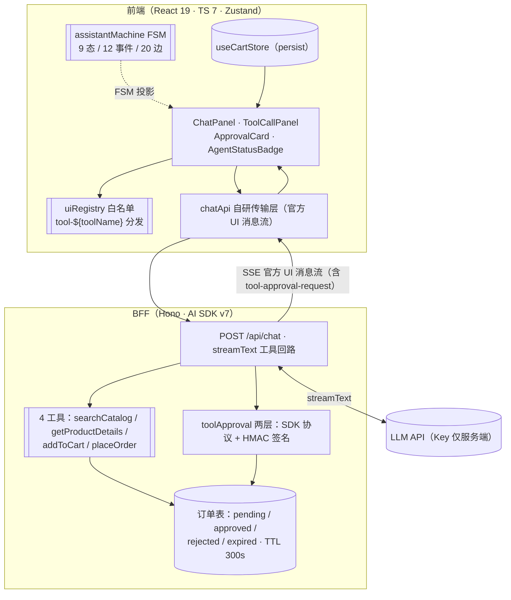

# wiki 增补节草稿：`connect-store-architecture.md` · AI 导购助手节

> **本文件性质**：跨仓库授权闸门（G4.3 裁决②）下的**默认交付物**——用户尚未授权写 `~/wiki`，
> 本稿只产出于本仓库 `docs/wiki/`，由用户本人决定何时、以何种形式合入 `~/wiki/connect-store-architecture.md`。
> **本 G 对 `~/wiki` 零触碰**（未授权路径，G4.3 报告开头有授权状态声明）。
>
> **标记口径（沿用 todo G4.3 行原文）**：每个 § 标注适用公司 [🌍🚀🏛️] 与来源可信度
> （🟢 = 仓库内实测 / 🟡 = 文档转述 / 🔴 = 推断）。emoji 图例沿用 `~/wiki` 存量节定义；
> 本稿按常见用法预填（🌍 外企/海外团队、🚀 创业/新业务团队、🏛️ 大厂/成熟团队）——
> **若与存量节不一致，以授权时用户确认 / 存量节为准**。
>
> **数字口径 = README 门面口径**（G4.2 签核，8bed604）：根 137（20 文件 ~6s）/ server 72
> （9 文件 ~2s）/ E2E mock 23（~26s）/ TTL 300s / HMAC 签名 / await_human。事实源
> `docs/regression-index.md` §1，终版 design v0.5 §1.1 / §3 / §5。

## 插入位置说明

- **目标文件**：`~/wiki/connect-store-architecture.md`（本仓库不可见，默认不可写）。
- **插入点**：建议追加在既有「connect-store 目录架构」节之后、作为新顶级节
  `## AI 导购助手（HITL 下单审批）`；若该文件存在「面试叙事 / 项目亮点」类汇总节，
  插到它之前（本节是架构节的延伸，不是总结陈词）。
- **保留旧内容**：纯追加，不动任何既有行（授权形态下 diff 证明无删改旧行）。
- **检索锚点**：若用脚本合入，按标题 `^## ` 遍历定位最后一个 `connect-store` 架构节结尾
  （下一个 `^## ` 或 EOF）插入。

## 三方对账小表（wiki 草稿 ↔ README ↔ regression-index §1）

| 数字/口径     | 本 wiki 草稿            | README（门面）                  | regression-index §1                 | 一致 |
| ------------- | ----------------------- | ------------------------------- | ----------------------------------- | ---- |
| 根单测        | 137（20 文件 ~6s）      | 137 cases / 20 files (~6s)      | 137 用例 / 20 文件 / ~6s            | ✅   |
| server 单测   | 72（9 文件 ~2s）        | 72 cases / 9 files (~2s)        | 72 用例 / 9 文件 / ~2s              | ✅   |
| E2E mock      | 23（~26s）              | 23 cases E2E-AI-01~24 (~26s)    | mock 23 条 / ~26s                   | ✅   |
| 审批 TTL      | 300s                    | 300s TTL（双拦截）              | server 侧 APPROVAL_TTL_MS = 300_000 | ✅   |
| 审批签名      | HMAC（APPROVAL_SECRET） | HMAC（签名防伪造）              | API-AI-06 伪造审批拦截 ✅           | ✅   |
| HITL 挂起状态 | await_human             | pauses at `await_human`         | design §5 / G3.3 落地               | ✅   |
| live 冒烟     | E2E-AI-09 手动不进 CI   | manual, not in CI               | 手动，不进 CI                       | ✅   |
| BFF 端口      | :8787                   | `npm run dev:bff`（Hono :8787） | 8787 预检口径                       | ✅   |

---

## 片段正文（以下为待插入 `~/wiki/connect-store-architecture.md` 的自包含内容）

<!-- INSERT-START: ## AI 导购助手（HITL 下单审批） -->

## AI 导购助手（HITL 下单审批）

### 定位 🌍🚀🏛️ 🟢

在存量数字资产目录（React 19 + TS 7 + Vite 8 目录站）上叠加的对话式导购：用户自然语言提问
（"20 刀以内适合做游戏封面的素材"），LLM 经工具调用操作目录，结果以 Generative UI 商品卡渲染；
下单是不可逆副作用，必须人工审批后才执行。面试叙事三件套：**状态机投影、Generative UI
白名单、HITL 分级审批**。设计终版见仓库 `docs/ai-assistant-design.md` v0.5。

### 架构图 🌍🚀 🟡

> 转述自 design v0.5 §3 全系统架构图（同构简版）；节点与实现文件一一对应见 design §3 图注。

### 特性 🌍🚀 🟢

- **Streaming UI**：官方 UI 消息流（SSE）+ 打字机渲染；前端自研传输层消费协议，不发明协议。
- **Tool loop**：`searchCatalog`（关键词/计价/排序/价格区间）/ `getProductDetails` /
  `addToCart` / `placeOrder` 四工具，工具调用面板可视化（名称/参数/状态/耗时）。
- **Generative UI**：白名单注册表按官方 `tool-${toolName}` 分发——搜索结果复用目录页
  ProductGrid / ProductCard（视觉同源），未注册工具一律降级文本，绝不渲染任意组件。
- **目录底座复用**：IntersectionObserver 无限滚动、URL 同步筛选、确定性排序；AI 导购与目录页
  共用同一份 BFF 冻结快照，推荐与目录永不打架。

### HITL 流程（六步） 🚀🏛️ 🟢

1. **Chat** — 用户口语提问，LLM 流式回复。
2. **Recommend** — `searchCatalog` 渲染商品卡。
3. **Add to cart** — `addToCart` 写入 persist 购物车（侧栏 CartDrawer）。
4. **Propose** — `placeOrder` 在 BFF 被 `toolApproval` 拦下，前端进入 `await_human`，
   ApprovalCard 展示条目 / 数量 / 合计。
5. **Decide** — 三出边：**approve** → 回放审批 → 执行下单返回订单号；**reject**（附理由）→
   LLM 按理由重规划；**edit**（改数量/删项）→ 不发审批响应、新 toolCall 重新发起 → 再次审批。
6. **Confirm** — 对话流携带订单号收尾。

> 双拦截：pending 超 **TTL 300s** 惰性过期（复放时 server 拒执行）；伪造审批载荷过不了
> **HMAC 签名**（绑定 toolName + toolCallId + input）。

### 测试三层 🏛️🌍 🟢

| 层          | 命令                    | 规模                       | 门禁            |
| ----------- | ----------------------- | -------------------------- | --------------- |
| 根单测+集成 | `npm test`              | 137 用例 / 20 文件（~6s）  | pre-commit      |
| BFF 单测    | `cd server && npm test` | 72 用例 / 9 文件（~2s）    | pre-commit + CI |
| E2E（mock） | `npm run test:e2e`      | 23 条 E2E-AI-01~24（~26s） | CI              |

live 冒烟 `npm run test:e2e:live`（E2E-AI-09）手动执行、不进 CI（需真实 LLM key）；
状态机 20 边转换表驱动测试 + zod 运行时校验白名单 + mock LLM 确定性测试是质量工程三支点。

### 部署 🌍🏛️ 🟡

push `main` → GitHub Pages 静态部署 `dist/`（`workflow_dispatch` 可手动重跑），BFF（Hono :8787）
常驻进程单独部署、Pages 工作流不含 BFF 步骤。

<!-- INSERT-END -->

---

## 与既有节的衔接说明

1. 本节**纯追加**，与既有「connect-store 目录架构」节是「存量底座 + AI 增量」关系：catalog /
   productApi / Zustand 底座描述不重复展开，只引用（见「特性」的目录底座一条）。
2. 若既有节含测试/部署总表，本节给出的是 **AI 导购域的三层细分口径**（137/72/23），
   与总表数字应一致；不一致时以 `docs/regression-index.md` §1 事实源为准并回改总表。
3. 数字更新节奏：README（门面）→ `docs/regression-index.md` §1（事实源）→ 本节，三者漂移时
   以事实源为准。
